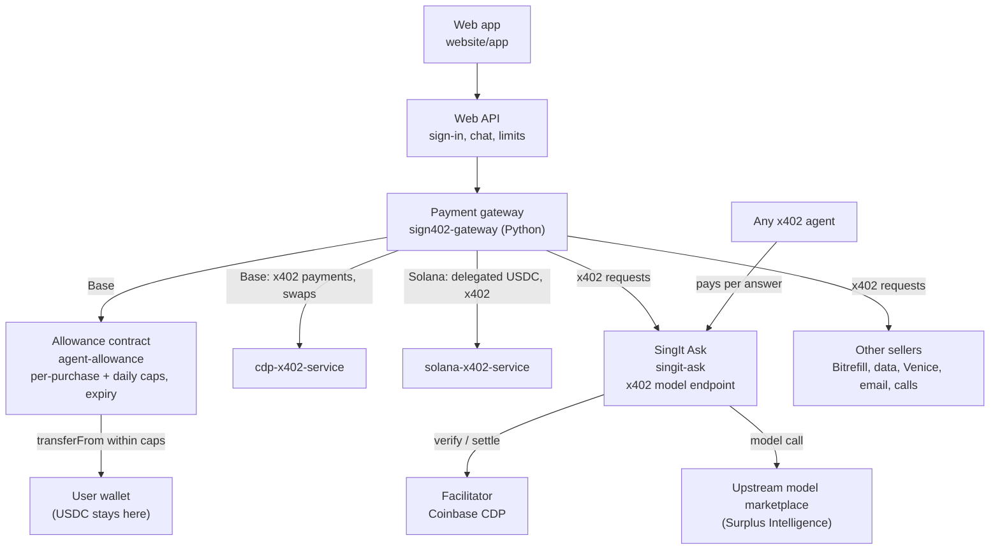
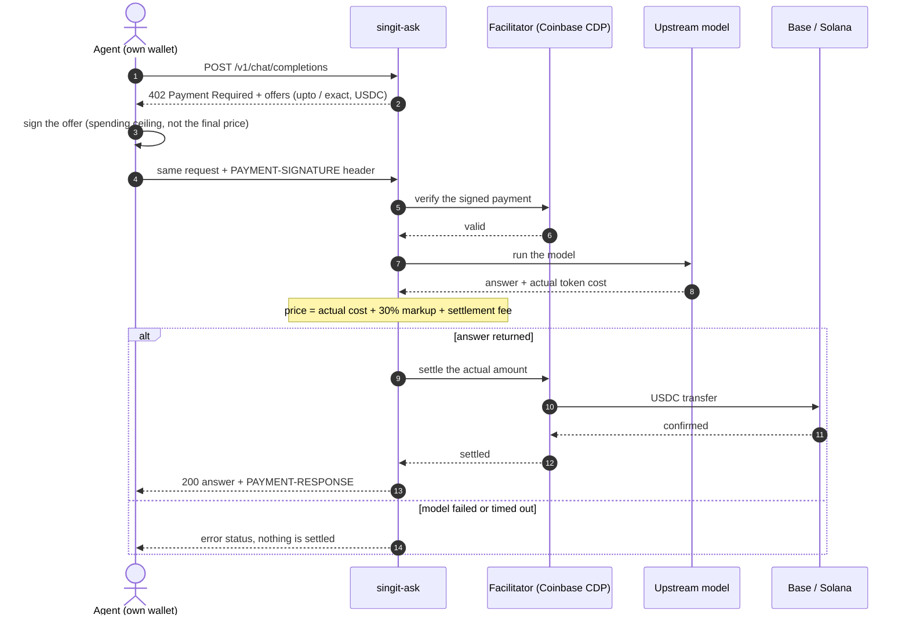
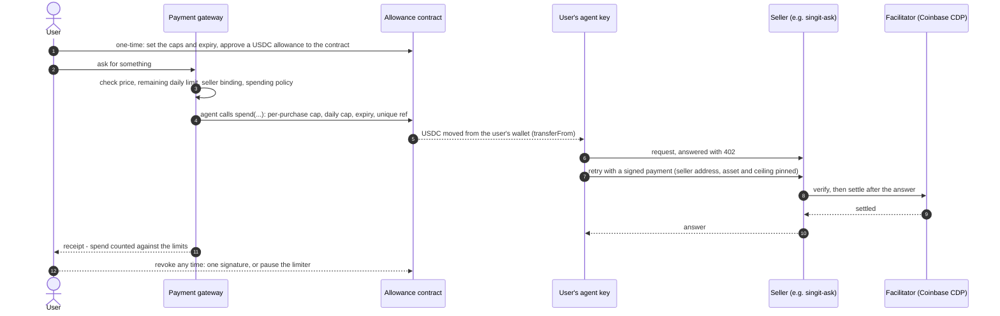

# Architecture

How a payment moves through SingIt, from a request to a settled USDC transfer. This page
covers the components and the x402 flows; the [root README](../README.md) has the product view
and [`sign402-gateway/SECURITY.md`](../sign402-gateway/SECURITY.md) the trust boundaries.

## Components

| Component | Directory | Role |
| --- | --- | --- |
| Web app and Web API | `website/app/`, `sign402-gateway/` | Sign-in, chat, limits; calls the gateway. |
| Payment gateway | `sign402-gateway/` | Checks prices, limits, seller bindings and spending policy before any money moves. |
| Allowance contract | `agent-allowance/` | `AgentAllowance` on Base: the agent can only call `spend`, inside a per-purchase cap, a daily cap and an expiry. No admin or upgrade path. |
| Base x402 helper | `cdp-x402-service/` | Does the CDP wallet and x402 work after the gateway has approved a payment. |
| Solana x402 helper | `solana-x402-service/` | Delegated USDC approvals and x402 payments on Solana. |
| SingIt Ask | `singit-ask/` | x402 endpoint that sells model answers and bills by actual cost. |
| Facilitator | external (Coinbase CDP) | Verifies a signed payment and settles it on chain. |

## x402 flow: any agent calls SingIt Ask

An agent with its own wallet needs no account or API key. On Base it signs a bounded
`upto` authorization; SingIt Ask settles only what the answer actually cost.

## x402 flow: the SingIt agent pays from a spending limit (Base)

The user's USDC stays in their wallet. The user approves a USDC allowance to their own
limiter contract once; the agent can then move only what a purchase needs, inside the caps
fixed in that contract.

A spend that breaks a cap, arrives after expiry, reuses a reference, or comes after a pause
reverts on chain, whatever the gateway or the agent asks for.

## Solana

Solana has no limiter contract. The user approves the agent as an SPL delegate on their own
USDC account for a total they choose; the chain caps that total. The gateway enforces the
daily and per-purchase limits before each payment, and the agent pays the seller over x402
straight from the user's account. For SingIt Ask on Solana the gateway first prepares a
measured invoice, then pays it with one x402 `exact` payment; the answer is released after
settlement.

## Invariants

- The language model never authorizes a payment; amounts are validated in code.
- A payment counts as made when the transfer shows on chain, not on the seller's word.
- A payment whose answer was lost is never repeated automatically; it stays counted against the limits.
- An operator kill switch stops every paying action at once.
